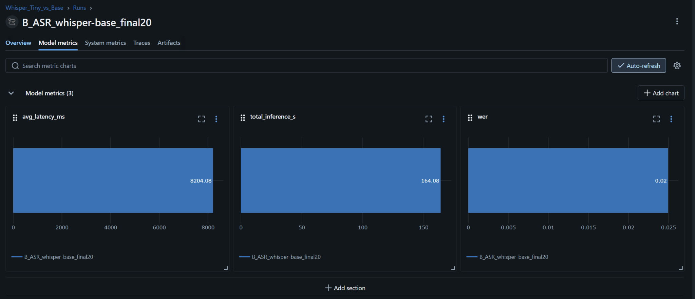
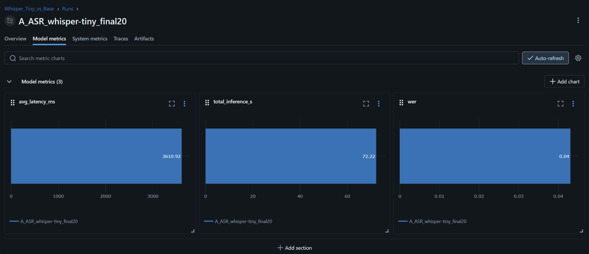
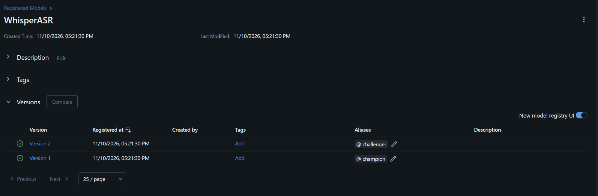
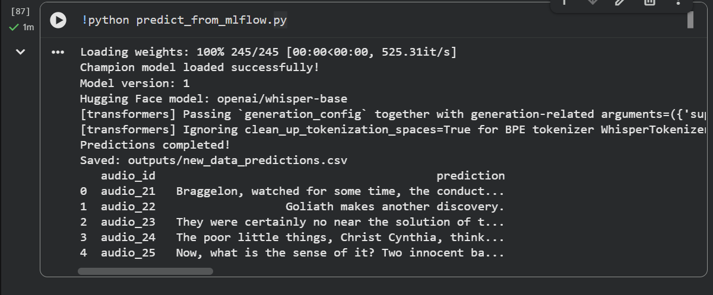

# Whisper Tiny vs Whisper Base: ASR Model Comparison using MLflow

## 1. Project Overview

This project compares two pretrained Automatic Speech Recognition (ASR) models from Hugging Face:

- Whisper Tiny (`openai/whisper-tiny`)
- Whisper Base (`openai/whisper-base`)

The objective is to evaluate their transcription accuracy and inference speed using the same audio dataset, track experiments using MLflow, and implement a Champion-Challenger model selection workflow.

## 2. Technology Stack

- Python
- Hugging Face Transformers
- OpenAI Whisper
- MLflow 3.18.0
- PyTorch
- LibriSpeech dataset
- Pandas, NumPy and Matplotlib

## 3. Dataset

Dataset: LibriSpeech Clean Test

Task: Automatic Speech Recognition

Evaluation samples: 20

Additional unseen test samples: 5

All models were evaluated on the same 20 audio recordings.

## 4. Models Compared

| Model | Hugging Face Model ID |
|---|---|
| Whisper Tiny | openai/whisper-tiny |
| Whisper Base | openai/whisper-base |

## 5. Evaluation Metrics

### Word Error Rate (WER)

WER measures transcription errors. Lower values indicate better transcription accuracy.

### Average Inference Latency

Measures the average time taken by a model to transcribe one audio recording. Lower values indicate faster inference.

## 6. Experimental Results

| Metric | Whisper Tiny | Whisper Base |
|---|---:|---:|
| WER | 4.31% | 2.49% |
| Average Latency | 3.61 seconds | 8.20 seconds |
| Total Inference Time | 72.22 seconds | 164.08 seconds |

## 7. Champion-Challenger Decision

The predefined decision rule was:

- Primary metric: WER (lower is better).
- Minimum absolute WER improvement: 0.005.
- Maximum acceptable WER: 0.05.
- Tie-breaker: Lower average inference latency.

Whisper Base achieved a WER improvement of 0.01814 over Whisper Tiny and satisfied the accuracy guardrail.

Therefore:

- Champion: Whisper Base
- Challenger: Whisper Tiny

Whisper Base was selected because of its higher transcription accuracy, despite its slower inference speed.

## 8. MLflow Experiment Tracking

MLflow was used to track:

- Model parameters
- WER
- Average inference latency
- Total inference time
- Prediction CSV files
- Comparison graphs
- Disagreement examples

The models were registered under one registered model name:

`WhisperASR`

| Alias | Model | Version |
|---|---|---:|
| champion | Whisper Base | 1 |
| challenger | Whisper Tiny | 2 |

## 9. New Data Prediction

The registered Champion was loaded using:

`models:/WhisperASR@champion`

Five new audio recordings were used to verify that the registered model could generate predictions.

The predictions were saved to:

`outputs/new_data_predictions.csv`

The standalone script `predict_from_mlflow.py` loads the model through the MLflow alias and generates predictions.

## 10. Project Structure

```text
Whisper-MLflow-Assignment/
│
├── data/
│   ├── audio/
│   ├── new_audio/
│   ├── eval_inputs.csv
│   └── new_data.csv
│
├── outputs/
│   ├── tiny_predictions_final20.csv
│   ├── base_predictions_final20.csv
│   ├── metrics_summary.json
│   ├── disagreement_examples.csv
│   ├── wer_comparison.png
│   ├── latency_comparison.png
│   └── new_data_predictions.csv
│
├── screenshots/
├── model_configs/
├── predict_from_mlflow.py
├── requirements.txt
└── README.md
```

## 11. How to Run

Install dependencies:

```bash
pip install -r requirements.txt
```

Configure MLflow tracking and registry to point to the database containing the registered model.

Run the prediction script:

```bash
python predict_from_mlflow.py
```

The script loads the Champion model through the MLflow Registry and saves predictions to the outputs directory.

## 12. Conclusion

Whisper Base achieved better transcription accuracy than Whisper Tiny on the 20-sample evaluation dataset.

Although Whisper Tiny was faster, Whisper Base satisfied the predefined accuracy-based selection criteria and was registered as the Champion.

The project demonstrates model comparison, experiment tracking, Champion-Challenger selection, model registration, aliases and inference using MLflow.


## MLflow Evidence

### Whisper Base Metrics


### Whisper Tiny Metrics


### Model Registry


### Champion Predictions

